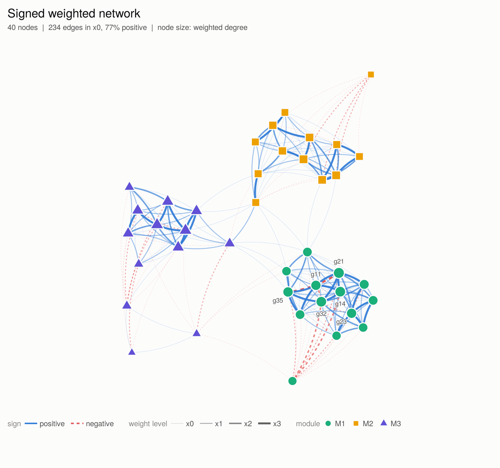
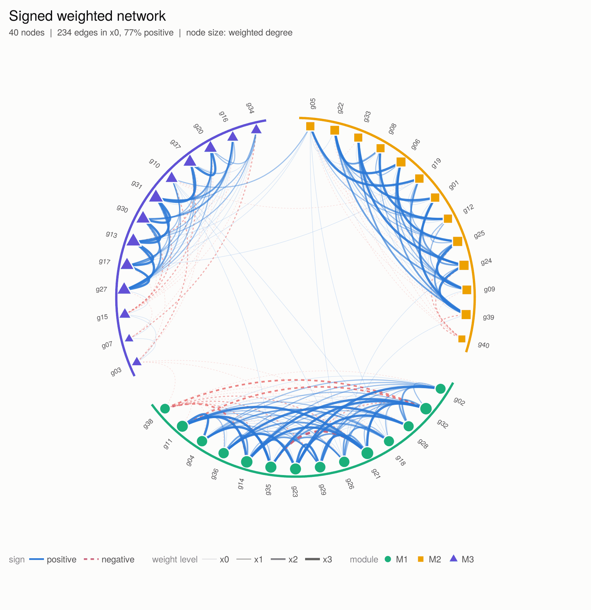
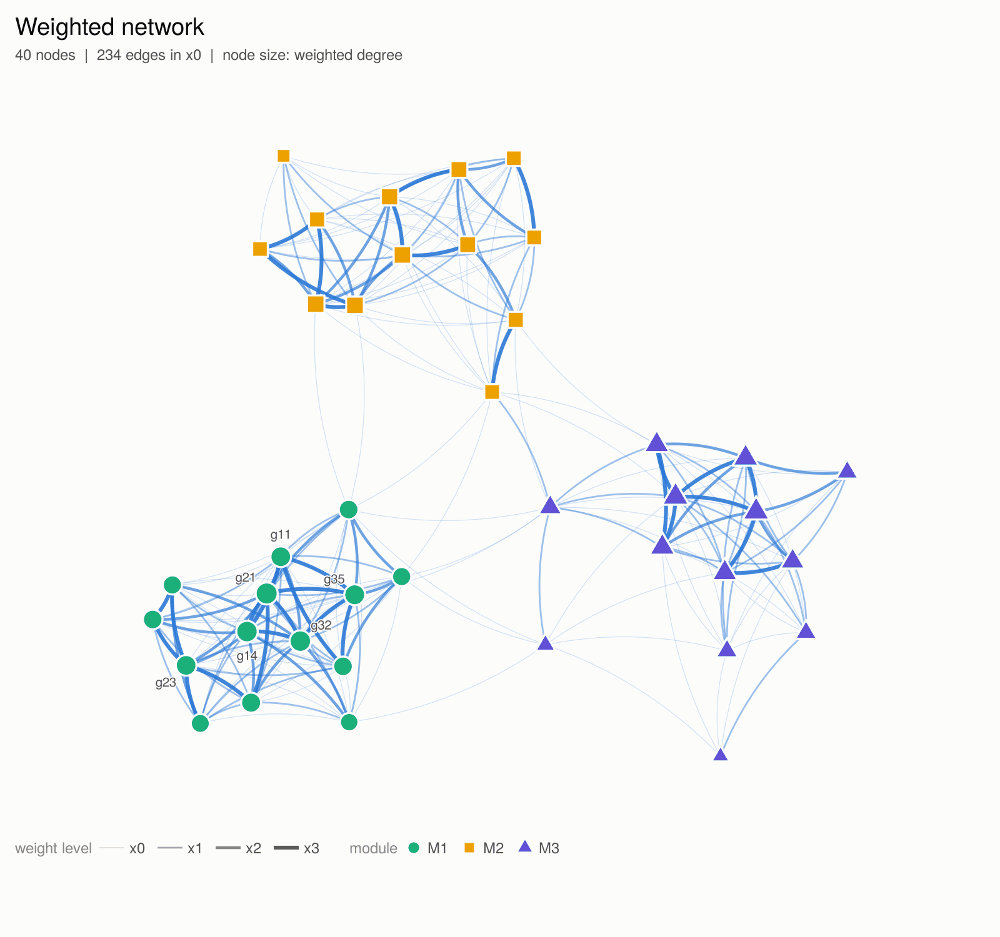
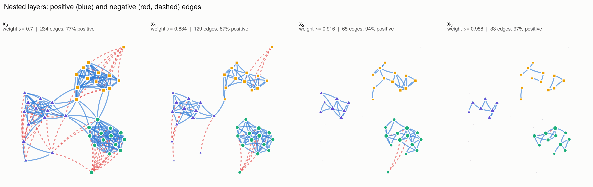
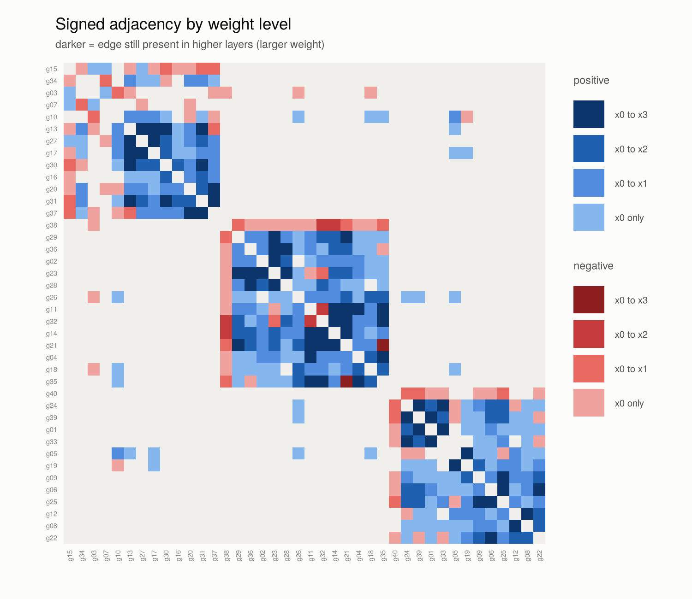
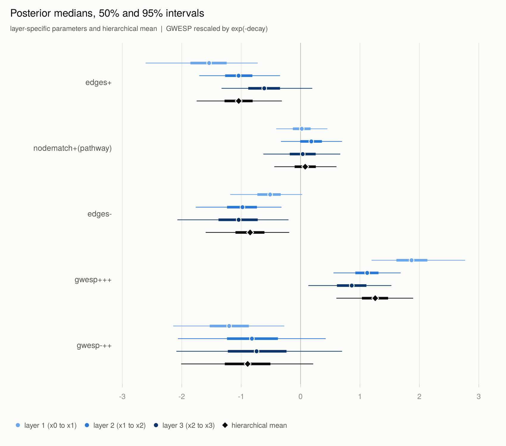
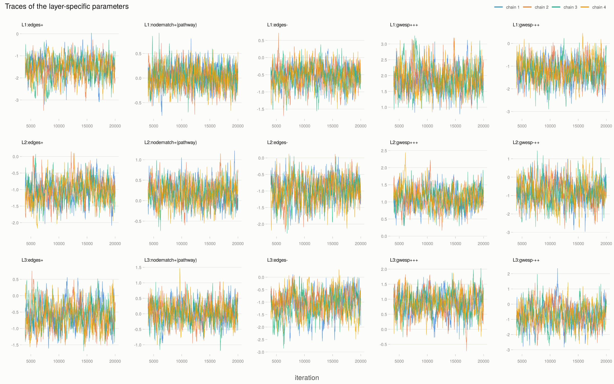
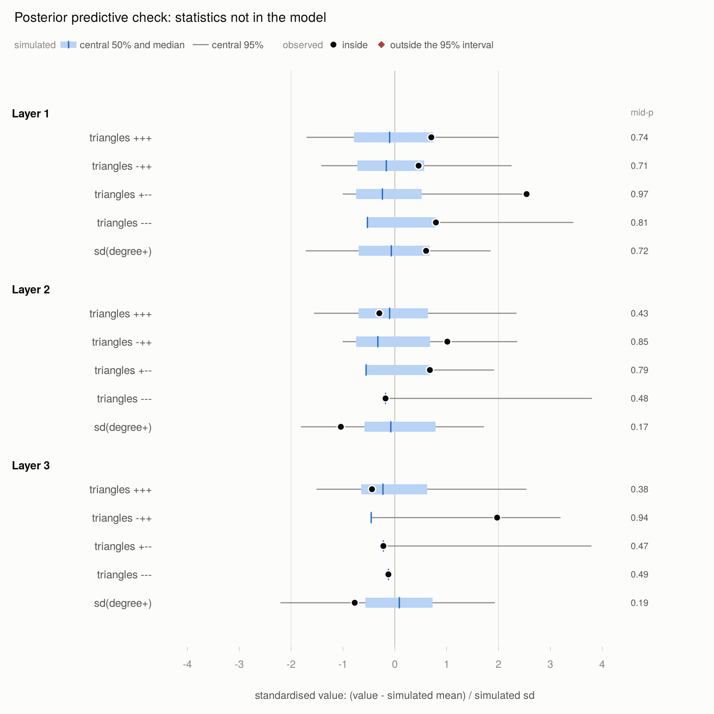

# Bergm.ws

Bayesian **multi-layer dissolution ERGMs** for **weighted** and **signed
weighted networks**.

A weighted network is cut into nested binary layers
x<sub>0</sub> ⊇ x<sub>1</sub> ⊇ … ⊇ x<sub>K</sub> by thresholding its edge
weights. Each transition x<sub>k−1</sub> → x<sub>k</sub> is modelled by an
exponential random graph model whose statistics are computed on layer k,
conditionally on the observed lower layers. The layer-specific parameters are
partially pooled by a Normal–inverse-Wishart hierarchical prior, and the
posterior is sampled with an adaptive approximate exchange algorithm.

| | network | function | layers in the formula |
|---|---|---|---|
| multi-layer, non-signed | weights | `bergm_w()` | `x_1`, ..., `x_K` |
| multi-layer, signed | weights and signs of the edges of x<sub>0</sub> | `bergm_ws()` | `x_1`, ..., `x_K` and the signs `z` |

Models are written as **ergm.multi** formulas, either layer by layer or once as
a template with `x_k`, which is repeated for every layer.

The examples use a small **simulated** network (`toy_ws`, 40 nodes, three
modules and a minority faction); no real data are included.

## Installation

```r
install.packages("Bergm.ws_0.1.0.tar.gz", repos = NULL, type = "source")
```

It needs **ergm** (≥ 4.6), **ergm.multi**, **network** and **coda**.

## Quick start

```r
library(Bergm.ws)
data(toy_ws)

## signed weighted network
dat <- ws_data(toy_ws$weights, toy_ws$thresholds, toy_ws$signs, toy_ws$attributes)
plot(dat, color_by = "module")
plot(dat, layout = "circle", color_by = "module")
plot_layers(dat, color_by = "module")
plot_adjacency(dat)

f <- ~ L(~edges, ~(z & x_k)) + L(~nodematch("pathway"), ~(z & x_k)) + L(~edges, ~(!z & x_k)) +
  gwespL(0.5, fixed = TRUE, L.base = ~(z & x_k), Ls.path = list(~(z & x_k), ~(z & x_k))) +
  gwespL(0.5, fixed = TRUE, L.base = ~(!z & x_k), Ls.path = list(~(z & x_k), ~(z & x_k)))
mod <- ws_model(dat, f, scale = "gwesp")   # check the formula, see the statistics
mod
fit <- bergm_ws(mod, n_iter = 10000, burnin = 2500, thin = 2, n_chains = 4, cores = 2)
summary(fit)
plot(fit, type = "intervals")
plot(fit)

pp <- ws_predictive(fit, nsim = 200)
plot(pp, what = "gof")
ws_aux_check(fit)

## the same weights without signs
datu <- ws_data(toy_ws$weights, toy_ws$thresholds, attributes = toy_ws$attributes)
fitu <- bergm_w(datu, ~ L(~edges, ~x_k) + L(~triangle, ~x_k),
                n_iter = 6000, burnin = 1500, n_chains = 4, cores = 2)
summary(fitu)
```

In signed data `(z & x_k)` selects the positive edges of layer k and
`(!z & x_k)` its negative edges. A formula may also name the layers
explicitly (`x_1`, `x_2`, ...); the statistics must then be grouped by layer,
with the same terms in every layer, because the hierarchical prior pools the
j-th statistic of all layers. `scale = "gwesp"` multiplies every GWESP
statistic by e<sup>−α</sup>, so that its coefficient is on the same scale in
every layer.

`demo("toy_example", package = "Bergm.ws")` runs both workflows.

## Vignette

```r
vignette("Bergm.ws", package = "Bergm.ws")
```

One Quarto vignette covers the model and its notation, a complete analysis of
a signed network with `bergm_ws()`, the same weights without signs with
`bergm_w()`, and the adaptive exchange algorithm with a comparison of its
parts. The code uses the names of the notation (`w`, `t_k`, `z`, `y`, `s`,
`phi`, `mu`, `post`, `y_rep`, ...). The comparison of the samplers is stored
with the package; the script that computed it is
`system.file("scripts", "precompute_vignettes.R", package = "Bergm.ws")`.

## What is in the package

**Data and model**

* `ws_data()` builds the layers and the support constraints from a weight
  matrix (e.g. confidence scores) and the thresholds, and optionally the signs
  from a sign matrix (e.g. correlations). `ws_simulate()` simulates small
  weighted networks with modules, signed (with an antagonistic faction) or
  not.
* `ws_model()` takes the `ergm.multi` formula, expands a template written
  with `x_k` to all layers, and checks that every statistic of transition k is
  computed on layer k only and that every layer has the same statistics, so
  that a copy-paste error in a long formula cannot go unnoticed. It also
  reports statistics that are zero in the data and statistics whose change
  statistics are nearly collinear, whose parameters are then separated mostly
  by the prior, and gives the statistics short names (`edges+`, `gwesp-++`,
  ...).

**The adaptive exchange algorithm (`bergm_w()`, `bergm_ws()`)**

None of the following changes the posterior; each one makes the sampler
cheaper or more robust.

* **Joint or layer-wise updates.** `update = "joint"` proposes all parameters
  at once with one auxiliary network, and is robust to posterior correlations
  within and between layers; `update = "layer"` is the classical scheme with
  one exchange step per layer.
* **Delayed acceptance.** A Gaussian approximation of the log-likelihood
  (score and Fisher information at the starting value) screens each proposal
  first; the auxiliary network is simulated only for the proposals that pass,
  and a second stage corrects exactly. On the toy example only about 45% of
  the proposals need a simulated network.
* **Hierarchical mean integrated out.** The exchange step targets
  p(φ | Σ, y), with μ integrated out analytically, and μ is then drawn from its
  full conditional: a partially collapsed Gibbs sampler. This removes the
  coupling between the layer parameters and their common mean; on the toy
  example it gives about 1.7 times more effective samples per iteration.
* **Starting values.** Penalised maximum pseudo-likelihood (always finite,
  unlike the plain MPLE when a statistic separates the dyads), then
  moment-matching Newton steps towards the posterior mode.
* **Proposal learned in three phases.** The proposal covariance starts from
  the Fisher information plus the prior precision. During the first three
  quarters of the burn-in every chain re-estimates it from its own history
  (adaptive Metropolis); the within-chain covariances are then pooled across
  chains, the last quarter only tunes the scale, and the proposal is frozen.
  The retained draws of all chains come from the same fixed Markov kernel.
* **Several chains** from dispersed starting points, in parallel, with Rhat,
  effective sample sizes and acceptance rates in `summary()`.
* `ws_aux_check()` compares the auxiliary networks with networks from much
  longer chains, to check that `aux_iters` is large enough.

On the toy example (15 layer parameters, 4 chains × 20,000 iterations,
11 minutes on 2 cores) all Rhat values are below 1.02 and the smallest
effective sample size is 281.

**Predictive checks (`ws_predictive()`)**

Prior and posterior predictive simulation, compared with the observed network
on the model statistics and on statistics that are **not** in the model, in
every layer: signed triangle counts (`+++`, `-++`, `+--`, `---`) and the spread
of the positive degrees for signed networks; triangles, spread and maximum of
the degrees otherwise. `plot()` shows each statistic standardised by its
simulated distribution, so that all of them fit on one axis, with mid-p values.

**Visualisation**

* `plot(dat)`: positive edges in blue, negative edges in red (dashed), with the
  weight level encoded by width and opacity; stress layout in which strong
  positive edges are short and negative edges are long, or a circular layout
  grouped by a node attribute (`layout = "circle"`).
* `plot_layers()`: the nested layers side by side on the same layout.
* `plot_adjacency()`: the signed adjacency matrix by weight level, ordered so
  that modules appear as blocks.
* `plot(fit, type = "intervals")`: posterior intervals of every effect in every
  layer next to the hierarchical mean; `plot(fit)`: traces or densities.

## Gallery (simulated toy network)










## The model in one formula

p(z, x<sub>1:K</sub> | x̃<sub>0:K−1</sub>, φ) ∝
exp{Σ<sub>k</sub> φ<sub>k</sub>ᵀ s(z, x<sub>k</sub>)} ·
Π<sub>k</sub> 1{x<sub>k</sub> ⊆ x̃<sub>k−1</sub>},
with φ<sub>k</sub> | μ, Σ ~ N(μ, Σ), μ ~ N(μ<sub>0</sub>, Σ<sub>0</sub>),
Σ ~ IW(ν<sub>0</sub>, S<sub>0</sub>),

where x̃<sub>k−1</sub> is the observed layer k−1 and z the signs
(`bergm_ws()`); without signs (`bergm_w()`) the statistics are
s(x<sub>k</sub>) and z is dropped. Simulated networks are
conditional on the observed lower layers and need not be nested.

## References

Caimo, A. and Gollini, I. (2020). A multi-layer exponential random graph
modelling approach for weighted networks. *Computational Statistics & Data
Analysis*, 142, 106825.

Caimo, A. and Friel, N. (2011). Bayesian inference for exponential random graph
models. *Social Networks*, 33, 41–55.

Christen, J. A. and Fox, C. (2005). Markov chain Monte Carlo using an
approximation. *Journal of Computational and Graphical Statistics*, 14,
795–810.

Haario, H., Saksman, E. and Tamminen, J. (2001). An adaptive Metropolis
algorithm. *Bernoulli*, 7, 223–242.

Krivitsky, P. N., Koehly, L. M. and Marcum, C. S. (2020). Exponential-family
random graph models for multi-layer networks. *Psychometrika*, 85, 630–659.

Murray, I., Ghahramani, Z. and MacKay, D. (2006). MCMC for doubly-intractable
distributions. *Proceedings of the 22nd Conference on Uncertainty in Artificial
Intelligence*, 359–366.

van Dyk, D. A. and Park, T. (2008). Partially collapsed Gibbs samplers: theory
and methods. *Journal of the American Statistical Association*, 103, 790–796.
